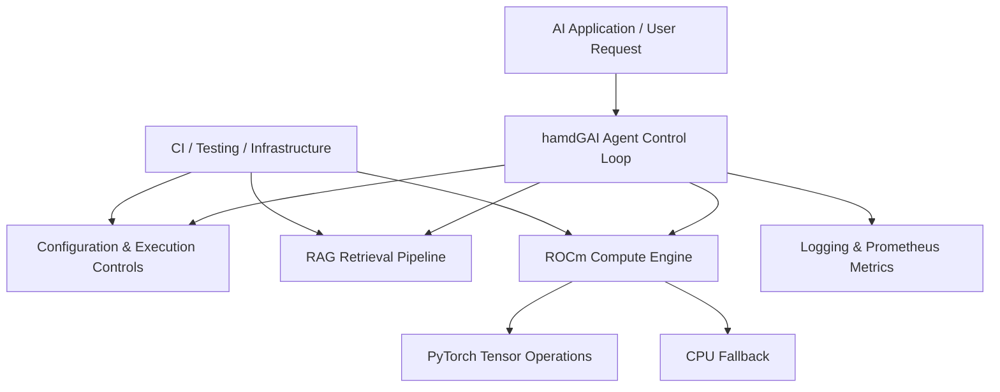

# hamdGAI

<div align="center">

# Hybrid Agent Intelligence & AMD Compute Architecture

**An extensible AI agent framework integrating intelligent execution, grounded retrieval, AMD ROCm acceleration, and enterprise-oriented observability.**

<br/>


**Designed for modularity. Built for verifiable engineering.**

</div>

---

## 🚀 Project Overview

**hamdGAI** is a modular AI agent and compute framework designed to bring together controlled agent execution, retrieval-augmented generation (RAG), AMD GPU computation, and operational monitoring.

The architecture combines Python-based orchestration with PyTorch compute operations, structured configuration, retrieval pipelines, and infrastructure automation.

Its engineering direction is to provide a foundation for dependable AI systems that can be extended, tested, monitored, and deployed across suitable computing environments.

## 🧠 Core Technology Domains

| Technology Domain | Implementation |
|---|---|
| Agent Orchestration | Modular agent control loop and execution management |
| Retrieval-Augmented Generation | Grounded passage retrieval and similarity matching |
| AMD Compute | ROCm-oriented PyTorch tensor operations |
| Compute Primitives | GEMM, FFT, Cholesky and related demonstrations |
| Configuration | Pydantic settings and environment-based configuration |
| Observability | Structured logging and Prometheus metrics |
| Infrastructure | Terraform-based infrastructure definitions |
| Quality Engineering | Pytest, coverage and automated CI checks |

## 🏛️ High-Level Architecture



## 🎯 Engineering Vision

The long-term objective is to evolve hamdGAI into a robust, extensible AI infrastructure platform with:

- Controlled and observable agent execution.
- Grounded information retrieval.
- Hardware-aware AMD compute acceleration.
- Reproducible and testable engineering workflows.
- Secure configuration and infrastructure management.
- Clear interfaces for future enterprise integrations.

**Project Author:** MD ABUL HOSSAIN

**Repository:** [AnticipatedD/hamdGAI](https://github.com/AnticipatedD/hamdGAI)

---

## Environment Variables

| Variable Name | Description | Default / Example |
| :--- | :--- | :--- |
| `AGENT_MAX_STEPS` | Maximum recursive execution loop steps for agents | `10` |
| `ROCM_API_KEY` | Authentication key for ROCm service bindings | `rocm_sec_key_123` |
| `PROMETHEUS_PORT` | Port exposed for operational metrics collection | `9090` |
| `AI_SEARCH_CONN_ID` | Azure AI Search Connection Identifier | `search_conn_01` |
| `AZURE_SUBSCRIPTION_ID` | Azure Subscription GUID for deployment scripts | `00000000-0000-0000-0000-000000000000` |

## Quickstart Guide
# Execution & Testing

### 1. Installation
Ensure Python 3.11+ is installed, then clone and install pinned dependencies:
```bash
python -m venv .venv
source .venv/bin/activate
pip install -r requirements-lock.txt
```
### 2. Running Tests
Run the complete test suite (includes CPU fallback tests for GPU acceleration routines):
`bash
pytest tests/ -v --cov=. --cov-fail-under=60
`
### 3. Smoke Test
Run the core agent runtime loop:
`bash
python hamdGAI_init.py
`
### 4. Health Check
Start the FastAPI app and query the health endpoint:
`bash
uvicorn health:app --reload
curl http://localhost:8000/health
` 

---

### Core System Features & Architecture 

# Key Design Principles

- **Explicit Tool Contracts**: Typed input validation, structured exception handling, and full execution provenance.
- **​Controlled Execution Budgets**: Strict step budgets, error thresholds, and escalation pathways.
- ​**Grounded Decision Making**: Clear separation of verified facts from model-generated summaries via RAG pipelines.
- **​Hardware Acceleration**: AMD ROCm GPU PyTorch kernels with seamless CPU fallback capabilities.
- **Structured Logging**: All modules use structlog for consistent observability.

---

 ## 🏗️ Repository Architecture

hamdGAI is organized around modular AI execution, AMD ROCm compute, retrieval, observability, infrastructure automation, and automated testing.

The structure below highlights the principal components and their responsibilities.

### 📂 Project Structure

```text
hamdGAI/
│
├── .github/
│   └── workflows/
│       └── ci.yml
│
├── terraform/
│   └── main.tf
│
├── tests/
│   ├── test_rag_pipeline.py
│   ├── test_rocm_engine_cpu.py
│   ├── test_rocm_engine.py
│   ├── test_rocm_primitives_demo.py
│   ├── test_config.py
│   ├── test_errors.py
│   └── test_metrics_exporter.py
│
├── config.py
├── errors.py
├── metrics_exporter.py
├── hamdGAI_init.py
├── rag_pipeline.py
├── rocm_engine.py
├── rocm_primitives_demo.py
│
├── health.py
├── .env.example
├── pyproject.toml
└── requirements-lock.txt
```

### ⚙️ Core Architecture

| Component | Responsibility |
|---|---|
| `hamdGAI_init.py` | Main application entry point and agent control loop |
| `config.py` | Typed configuration and environment settings |
| `errors.py` | Centralized application exception hierarchy |
| `rag_pipeline.py` | Retrieval-augmented generation and vector matching |
| `rocm_engine.py` | AMD ROCm tensor computation engine |
| `rocm_primitives_demo.py` | GEMM, FFT, convolution and decomposition demonstrations |
| `metrics_exporter.py` | Prometheus metrics and telemetry collection |
| `health.py` | Application health monitoring |
| `terraform/` | Infrastructure-as-code definitions |
| `tests/` | Automated validation of application and compute components |
| `.github/workflows/` | Continuous integration and quality-control automation |

### 🧪 Engineering & Quality Assurance

The project incorporates automated testing and continuous integration to support:

- Application logic and configuration validation.
- RAG retrieval and vector-matching verification.
- ROCm compute execution and CPU fallback testing.
- GPU-oriented computational primitive validation.
- Prometheus telemetry testing.
- Automated CI quality checks.

### 🔒 Configuration & Reproducibility

- `.env.example` — Environment configuration template.
- `pyproject.toml` — Python project configuration and development tooling.
- `requirements-lock.txt` — Pinned dependency versions for reproducible installation.

### 🎯 Architectural Objective

hamdGAI is designed to evolve into a modular, production-oriented AI infrastructure framework, combining intelligent agent execution, grounded retrieval, AMD GPU acceleration, observability, and infrastructure automation.

**Engineering principle:** Every documented capability should correspond to real, maintained, and verifiable implementation in the repository.

---

# License & Citation 
Copyright © 2026 MD ABUL HOSSAIN. All Rights Reserved.  
Distributed under the MIT License. See [Looks like the result wasn't safe to show. Let's switch things up and try something else!] for details.
